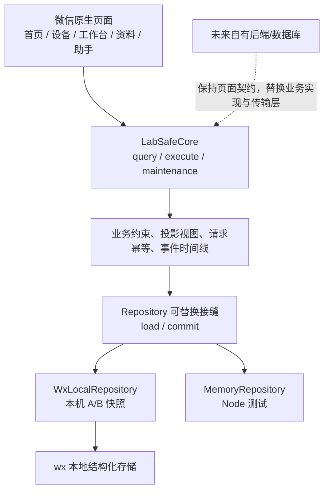

# LabSafe AI｜原生微信小程序架构与后续实施步骤

> 版本：架构落地 V0.1（2026-10-15）  
> 定位：竞赛演示用、单机本地优先、全部虚构数据。本文区分**本次已落地**与**后续待做**；不把演示角色、本机事件记录或关键词检索称为真实认证、可信审计或大模型 AI。

## 1. 本阶段交付边界

本阶段交付一个可导入微信开发者工具的原生 JavaScript 小程序工程骨架，并打通第一条竖切片：

```text
首页/设备列表 → 设备详情 → 提交模拟异常 → 异常详情及本机时间线
```

五个一级入口为：首页、设备、工作台、资料、助手。工作台展示巡检与异常记录，支持按状态过滤、逐项填写巡检模板并提交；设备页支持本机虚构实验室/设备的登记与编辑；异常详情页可按状态机推进确认/分派/处理/复核/关闭，并可记录图片附件元数据（文件名/大小/本机路径）与检查文件存在性；资料页支持本机关键词检索、引用复核与过期版本过滤；助手页用本地关键词规则生成可编辑异常/巡检草稿，确认后才提交；首页提供 JSON 元数据备份导出/预检/恢复与容量告警。图片本体不进入 JSON 快照或备份；真实账号和后端均未在本阶段实现。

本工程使用虚构实验室、设备、巡检、异常与规程数据，不应输入真实人员、设备编号、事故或秘密资料。演示身份切换仅改变本机显示和事件中的角色标记，不具备访问控制能力。

## 2. 架构总览



页面只提交用户意图、显示结果，不直接操作 `wx.setStorageSync`，也不能指定任意异常目标状态。`LabSafeCore` 对页面只提供三个方法：读操作走 `query`，写操作走 `execute`，重置演示数据走 `maintenance`；输入校验、幂等与事件写入留在模块实现内部。当前写命令包括 `incident.report`、`demo.role.switch`、异常状态机的七个转移命令（confirm/reject/assign/start/submitReview/return/close）、台账命令（lab.create/lab.update/device.create/device.update/device.disable/device.enable）、`inspection.submit`、知识命令（document.import/document.revise/document.publish）与 `attachment.record`（仅元数据）。维护命令包括演示数据重置，以及 `backup.export/backup.precheck/backup.restore`。未来扩充命令时继续走核心，而不是让页面修改快照。当前 Repository 接缝有 `WxLocalRepository` 与 `MemoryRepository` 两个适配器；其“整份快照”接口只服务单机演示和测试。接自有数据库时应保持页面意图接口，但将校验、状态机和事件提交移到服务端，设计细粒度传输契约，不能把整份快照通过网络来回传输。

### 工程目录

```text
project.config.json                 微信开发者工具项目入口
miniprogram/
  app.js / app.json / app.wxss     应用启动、页面与全局样式
  pages/                          五个 Tab 与设备/异常详情
  runtime/bootstrap.js            唯一组合根，装配核心与仓库
  core/
    createLabSafeCore.js           查询、命令、输入校验、事件写入
    seed.js                        可重置的虚构演示数据，schema v2
    hash.js                        快照校验与幂等指纹
  infrastructure/
    WxLocalRepository.js           生产小程序本机存储适配器
    MemoryRepository.js            测试用内存适配器
tests/                             Node 自动化测试
research/github-projects.md       GitHub 工程调研，不等于已集成
LabSafe_AI_整合优化项目方案_V3.md     产品范围与总体设计依据
```

### 核心契约（JavaScript + JSDoc）

```js
await core.query({ type: 'device.list' })
// -> { items: [{ id, code, name, status, labName, ... }] }

await core.execute({
  type: 'incident.report',
  requestId: '本次提交的唯一编号',
  payload: { deviceId, title, description, severity: 'LOW' }
})
// -> { ok: true, data: { incident } }
// 或 { ok: false, error: { code, message } }

await core.query({ type: 'incident.detail', payload: { incidentId } })
// -> { incident, events: [{ action, from, to, actorRole, reason, at }] }
```

所有异常创建同时保存 `Incident` 与 `WorkflowEvent`；同一 `requestId` 和相同参数重复提交返回原结果，不重复创建；同一编号换参数会报错。事件是**本机演示轨迹**，无法抵抗设备持有人篡改，不是法规意义上的审计日志。

### 本地持久化与失败边界

`WxLocalRepository` 使用两槽快照 + 活跃指针：先写入非活跃槽、读回验证，再写活跃指针作为提交点。快照存 `schemaVersion`、`generation` 与 SHA-256 校验值；写入前限制单键大小。有效指针存在时，即便另一槽代次更高，也只读取指针指定的已提交版本。指针失效但两槽都有效时，保守回退到较低代次；只有一槽有效时无法区分已提交与未提交，显式报 `STORAGE_UNCERTAIN`，不会静默重置。目前尚无页面级恢复入口，应保留本机数据并在 G4 增加人工检查/导出恢复流程。

这只提高**单机结构化数据**在部分写入失败时的可恢复性，不是数据库事务、跨设备同步或完整备份。微信 `wx.setStorageSync` [单键 1 MB、总量 10 MB 的官方限制](https://developers.weixin.qq.com/miniprogram/dev/api/storage/wx.setStorageSync.html)意味着图片不能放进该 JSON 快照；后续附件应保存为本机文件并单独管理。临时文件不保证重启后有效，需依据[官方文件系统说明](https://developers.weixin.qq.com/miniprogram/dev/framework/ability/file-system.html)转存。

## 3. 领域对象与后续状态流

当前最小对象：`Lab`、`Device`、`Inspection`、`Incident`、`WorkflowEvent`、`Document`、`DocumentVersion`、`DocumentChunk`、`Attachment`、`Receipt`。以稳定 ID 关联，页面使用投影视图而非直接读取原始快照。附件仅记录元数据（实体、文件名、字节大小、本机保存路径），图片本体留在本机文件系统，不进入 JSON 快照、时间线或备份；异机恢复后附件元数据仍在，但文件路径按缺失处理并明确提示。

异常状态流（已在核心与页面层落地）：

```text
REPORTED → CONFIRMED → ASSIGNED → IN_PROGRESS → PENDING_REVIEW → CLOSED
               ↘ REJECTED                     ↖ RETURNED
```

状态只能由命令推进，例如 `CONFIRM`、`ASSIGN`、`START`、`SUBMIT_REVIEW`、`APPROVE`、`RETURN`；每次写入检查当前状态、记录版本 `revision`、演示角色、原因与时间。关闭前必须有处理说明与复核结论。真实多用户权限需要后端身份与服务端授权，不能依赖小程序内的角色开关。核心层为写入命令定义了本机演示角色矩阵 `COMMAND_ROLES`（2026-10-16 落地）：异常上报/巡检提交/附件记录对所有演示角色开放，状态推进与资料导入/修订/发布限教师/管理员，台账与设备编辑限管理员，越权命令返回 `ROLE_FORBIDDEN`；页面按 `demo.session` 隐藏越权入口。角色切换只是本机演示规则，不是真实权限控制；真实授权留给 G5 服务端。

知识检索只在**已发布且未过期**的版本上做确定性关键词匹配，命中返回原文与 `DocumentVersion`/章节；草稿版本、被替代版本和已过有效期版本都不参与检索。每条引用可通过 `knowledge.citation` 回到其原始版本：新版发布后旧版本保留为 SUPERSEDED，仍可原文复核；未命中返回 `NO_EVIDENCE`，不生成答案，也不补写操作建议。这是“可引用检索”的初始界面，不是语义搜索或 RAG。

助手草稿（G3）使用纯本地关键词规则（意图词、设备编号/名称、严重度词）把一句话解析为异常或巡检草稿：缺字段只列提示、不写入、不补写；同一输入可重复回放出一致结果；确认提交时调用与工作台相同的业务命令，设备停用等无效状态仍由核心拒绝。解析是关键词规则，不是语义理解或大模型 AI。

可恢复交付（G4）在维护层提供 `backup.export`（导出含 `kind/backupVersion/schemaVersion/checksum` 的 JSON 信封，不含图片二进制；单键超 900 KB 时给出容量告警）、`backup.precheck` 与 `backup.restore`。precheck 与 restore 共用核心层同一深度校验器（必需集合/字段、唯一 ID、`device.labId`、异常/巡检/模板指向的设备、事件指向的实体、文档→版本→片段、附件指向的实体及当前版本等关系；校验值证明字节未变，不证明业务关系有效，业务关系由该校验器负责），对 v1 备份先按明确规则迁移、再校验目标 v2；校验通过后按**将要写入的完整 `{generation, checksum, snapshot}` 槽记录**（与 `WxLocalRepository.commit` 同一口径的 `slotRecordBytes`）计算 UTF-8 字节数，超过 `MAX_RECORD_BYTES` 明确返回 `STORAGE_LIMIT`，不出现“预检可恢复、恢复必失败”。仓库接缝按“读旧写新”接受受支持的 v1/v2 本机快照并保留 A/B 指针提交语义，核心层迁移在验证成功后再把 v1 升为 v2；坏校验、单槽无可信指针、未提交的较新槽仍按原保守策略拒绝或回退，不静默重置。schema v1 备份迁移后，模板与知识集合为显式空集合并继续可写；恢复会把演示角色一并回到备份时刻。这是单机演示数据的导入导出，不是跨设备同步或数据库备份。

## 4. 后续实施顺序与通过条件

下面以 Gate 而非页面数量作为完成标准。每个 Gate 通过后再进入下一项，避免五个空页面同时扩张。

| 顺序 | 具体工作 | 可验收结果 / Gate |
|---|---|---|
| G0 当前骨架 | 用自有正式或测试号 AppID 在微信开发者工具导入工程；走通设备 → 上报 → 时间线；执行 `npm test`、`npm run check` | 自动化测试通过；冷启动、重复提交、重启后记录仍在；五个 Tab 无白屏。无真实 AppID 时仅完成静态/Node 验证，不宣称预览或真机通过。 |
| G1 管理闭环 | 增加本机虚构实验室/设备编辑、编号唯一性与停用规则；巡检模板与提交；异常确认/分派/处理/复核/关闭；命令级前置条件、`revision` 冲突、历史引用保留、列表过滤 | 模拟台账可编辑且可重置；状态流每条合法/非法边均有测试；异常无法跳步关闭；事件数量与状态一致；重启后可复现。演示角色矩阵已落为核心命令规则与拒绝测试（2026-10-16，见第 6 节验证记录）。 |
| G2 知识可信（已落地，资料页含最小导入/修订/发布入口，待人工验收） | 文档导入、不可变版本与发布、章节定位、过期过滤、引用卡片、无证据拒答；先做本地精确/关键词检索 | 展示的每条引用都能回到存在的原文版本；旧引用在新版发布后仍可复核；无命中不生成答案。 |
| G3 助手草稿（已落地，待开发者工具人工验收） | 本地规则将简短文字解析为可编辑异常/巡检草稿；缺字段时只提示，不执行写入；用户确认后再调用 G1 命令 | 草稿和保存分离；同一输入可重复回放；无效设备/状态被业务层拒绝。此阶段仍不称大模型 AI。 |
| G4 可恢复交付（代码已落地，P0 阻断项已修复，待人工验收） | 图片选择与转存、附件存在性检查、JSON 元数据备份/预检/恢复、schema 迁移、容量告警、演示数据一键重置 | 导出不包含图片二进制；异机导入明确提示附件缺失；坏备份不得部分覆盖；恢复后数据/事件/引用一致。 |
| G5 自有数据库 | 先定义服务端细粒度 API 与迁移契约，再建真实账号、授权、数据库、服务端事件与附件存储；保持页面 `query/execute` 语义但替换本地业务实现与传输层 | 服务端为写入权威；角色权限不能靠前端绕过；不传输整份本地快照；迁移前后计数与校验一致；离线冲突策略单独验收。 |

G0 的人工操作需要开发者工具和用户自己的 AppID。官方说明游客模式只能编辑本地项目；预览与开发需可用 AppID 及相应开发者身份，[测试号可用于入门](https://developers.weixin.qq.com/miniprogram/dev/framework/quickstart/getstart.html)。项目中的 `touristappid` 仅是占位，不能当成已具备真机预览能力。

## 5. GitHub 工程如何进入后续架构

先前的 [GitHub 调研](research/github-projects.md)属于候选技术库，不代表本阶段已经拉取或集成。当前单机 MVP 不接摄像头、PPE 检测、烟火识别、MQTT 或云端 RAG。G5 之后若有真实场景、数据授权、目标硬件与许可审查，可再评估：

- `mediamtx` 只负责视频接入，不处理业务状态；`onnxruntime` 与 `supervision` 分别负责推理和检测后处理；LabSafe 自有服务负责复核、事件与证据。
- `cvat` 用于标注闭环；`haystack` / `qdrant` 用于后端版本化知识检索，不能把凭据或高风险生成逻辑放进小程序前端。
- `ultralytics` 的 AGPL/商业许可与模型权重、数据集许可分别审查；不因为开源仓库能运行，就直接复制进竞赛交付或生产系统。

这些都是研究路线，不计入当前代码的完成率；详情与原始仓库链接见调研文件。

## 6. 现在如何继续

1. 以第 7 节的**最新验收后清单**为执行依据：三个数据完整性/可恢复性阻断项（P0-1～P0-3）已在自动化层修复并通过失败先行回归，产品范围差距（G1 演示角色矩阵、G2 资料管理入口）已按“落为核心命令规则 + 最小入口”路线补齐；当前待办是 7.3 的人工复验。上文的 G1–G4 实现记录是历史进度，不代表当前整体验收通过。
2. 每一轮修复后，在项目根目录运行 `npm test` 和 `npm run check`；当前没有第三方运行依赖，不需要 `npm install`。自动化通过后再在微信开发者工具中做本地编译与交互；微信 `app.json` 的五个文字 Tab 符合[官方配置要求](https://developers.weixin.qq.com/miniprogram/dev/reference/configuration/app.html)。
3. G0–G4 复验通过后再决定是否进入 G5 自有后端。竞赛演示、同事负责的模拟训练数据和正式多用户系统是不同交付范围，不互相替代。

**验收边界**：Node 测试和静态语法检查只能证明核心逻辑在测试环境中的行为；微信开发者工具编译、模拟器交互、真机持久化与真实实验室安全效果分别需要独立验证。本项目当前不对外宣称真实 AI 检测或安全决策能力。

**上次验证记录（2026-10-15）**：`npm test` 为 15/15 通过，覆盖核心、A/B 存储故障注入、并发重复提交和页面级上报/时间线联调；`npm run check` 通过，确认 15 个 JavaScript 文件可解析、7 个页面文件齐备、5 个 Tab 配置合法。尚未在微信开发者工具中编译，也未做模拟器/真机验收。

**本次验证记录（2026-10-16，G1 管理闭环页面层接入）**：`npm test` 为 24/24 通过，新增页面级闭环联调（实验室创建与编号冲突拒绝、设备登记/编辑/停用启用、异常从上报到关闭的五步 UI 推进、工作台状态过滤与巡检逐项提交）；`npm run check` 通过。G1 的自动化验收（状态机合法/非法边、`revision` 冲突、列表过滤、schema 迁移）已在核心测试中覆盖。仍需人工完成：微信开发者工具导入编译、模拟器交互与冷启动/重启持久化验收，方可宣告 G1 整体通过。

**本次验证记录（2026-10-16，G2 知识可信 + G3 助手草稿）**：`npm test` 为 27/27 通过，`npm run check` 通过。G2 新增 `document.import/revise/publish`（草稿不进检索、版本不可变、旧版本保留为 SUPERSEDED）、`knowledge.citation` 引用复核、`knowledge.document.list`，检索只回现行且未过期版本，测试覆盖“草稿不进检索→发布→修订发布 v2→旧引用可复核→过期过滤→无证据拒答→重复修订拒绝”。G3 新增 `assistant.parseDraft` 纯规则解析与助手页草稿确认流，测试覆盖“缺设备只提示且不写入、同输入可回放、未知意图提示、确认后经既有命令提交、停用设备提交被核心拒绝”。三个 Gate 均需在微信开发者工具中人工编译与交互验收后才宣告整体通过。

**本次验证记录（2026-10-16，G4 可恢复交付）**：`npm test` 为 31/31 通过，`npm run check` 通过。G4 新增 `attachment.record`（仅元数据、实体存在性校验、大小上限）、`incident.detail` 附件列表与页面级图片选择/转存/存在性检查（`wx.getFileSystemManager().access`）；维护层新增 `backup.export/backup.precheck/backup.restore`，核心读取路径接入 schema v1→v2 迁移（模板与知识集合迁移为显式空集合）。测试覆盖“导出 JSON 无图片二进制→导出后新增数据→恢复后数据/事件/引用回到备份时刻→恢复后可继续写入”、“校验值篡改/kind 错误/schema 99/null 备份全部拒绝且不部分覆盖”、“v1 备份预检不改动当前数据、恢复后迁移可读可写”、“附件输入校验、900 KB 容量告警阈值”。种子 schema 升为 v2；schema 1 在**核心配合测试仓库**读取时迁移的兼容测试保持通过，尚未覆盖真实 `WxLocalRepository` 持久化的 v1 路径，见第 7 节 P0-1。仍需人工完成：微信开发者工具编译、模拟器中图片选择/转存/重启后附件存在性、备份导出复制与坏备份恢复交互验收，且需先修复第 7 节阻断项，方可宣告 G0–G4 整体通过。

**本次验证记录（2026-10-16，P0-1～P0-3 修复 + G1 演示角色矩阵 + G2 资料管理入口）**：`npm test` 为 39/39 通过（31 既有测试全部保留 + 6 个 P0 失败先行回归 + 1 个角色矩阵拒绝测试 + 1 个资料管理页面测试），`npm run check` 通过（15 个 JavaScript 文件可解析、7 个页面文件齐备、5 个 Tab 配置合法）。三项 P0 均先以失败先行测试固化（初版 6/6 失败确认）再修复：P0-1 仓库接缝支持受支持的 v1/v2 快照“读旧写新”，端到端测试基于仿真 `wx` 存储覆盖“有效 v1 槽→启动查询→一次正常写入→重启后为 v2”，坏校验值、单槽无可信指针、未提交较新槽仍按原保守策略拒绝或回退；P0-2 核心层新增快照不变量深度校验器接入 precheck/restore，反例覆盖重算校验值的断裂设备引用、重复 ID、悬空当前版本、非法状态与 v1 断裂引用，拒绝后原快照、代次、指针与真实仓库落盘字节均不变；P0-3 预检与 `commit` 共享 `slotRecordBytes` 容量判定（按完整 `{generation, checksum, snapshot}` 槽记录计 UTF-8 字节，计入迁移膨胀与信封开销），阈值上下、中文多字节与 v1 迁移膨胀均有用例。G1 演示角色矩阵落为核心层 `COMMAND_ROLES` 与 `ROLE_FORBIDDEN` 拒绝测试（学生可上报/巡检/附件但不能推进状态或建台账；教师可推进与维护资料但不能编辑台账；管理员全量；`demo.role.switch` 始终可用且页面文案明示“本机演示规则，不是真实权限”），incident-detail/devices/device-detail 页按 `demo.session` 门控；G2 资料页新增最小导入/修订/发布入口与页面测试（导入→发布前检索不到→发布→检索命中 v1→修订→发布→检索命中 v2，学生看不到管理入口）。补充发现：恢复备份会把演示角色一并回到备份时刻（种子默认学生），管理命令需重新切角色，测试已按此语义调整。仍需人工完成：微信开发者工具编译、模拟器故障场景（有效 v1 本机数据、坏包、超限包，见 7.3）与真机附件/离线验收，方可宣告 G0–G4 整体通过；本记录只声称 Node 自动化与静态检查通过，不宣称预览或真机已验证。

**补充验证记录（2026-10-16，P0-2 字段与语义复核、首页备份复制反馈）**：39/39 通过后又发现“设备缺 `code`”“事件缺 `at`”等重算校验值仍能通过预检的反例，因此不能沿用当时“P0-2 已完整修复”的结论。本轮按 `core.maintenance` 与首页 `exportBackup` 两个公开入口先写失败用例，再补齐各集合被业务读取的必需字段、类型、编号唯一性、跨字段引用、每个资料版本至少一段正文及资料现行版本指针校验；可选的旧数据字段仅在有值时检查，避免误拒历史数据。伪造事件类型的原型链键、错误幂等回执、模板与设备不匹配等也被拒绝；巡检提交命令同步阻止写出模板/设备不匹配的数据。对旧 v1/v2 快照缺失的 `demoRole` 或 `receipts` 仅补默认学生角色/空回执，显式坏值仍拒绝，导出→预检→恢复可往返。备份预检与恢复共用校验，失败不覆盖现有数据及存储指针。首页只在剪贴板成功回调后显示“已复制”；复制失败保留 JSON 并显示手动复制入口，新一次导出失败会清除旧的成功提示。本轮实际运行 `npm test` **47/47 通过**，`npm run check` 通过（15 JS、7 页面、5 Tab）。以上仅为代码自动化结果；微信开发者工具、模拟器及真机尚未在本轮取得可复核证据。

## 7. 验收后下一步执行清单（2026-10-16）

### 7.1 当前结论与执行边界

上一轮只读验收中，`npm test` 为 **31/31 通过**，`npm run check` 通过；但额外的真实持久化适配器/备份场景复现出下表三个阻断项。因此当时状态是“**代码层已有 G0–G4 功能，整体验收未通过**”，不是“已完成可交付”。开发者工具本地编译、模拟器冷启动、真机附件与离线流程仍无通过证据。当前 Git `main` 尚无提交，工程文件均为未跟踪文件；修复前应先留可追溯基线，并检查 `project.private.config.json` 等本机配置，勿把私有信息直接纳入公开仓库。

**执行状态更新（2026-10-16）**：下表三个 P0 已按 7.2 顺序全部修复，并通过失败先行回归（39/39，见第 6 节本次验证记录）；7.2 第 5 步的 G1 演示角色矩阵与 G2 资料管理入口也已落地。表格保留作为问题与退出条件的记录；整体验收仍待 7.3 人工验收矩阵执行，自动化通过不等于模拟器/真机验收通过。

**后续复核（2026-10-16）**：上述 39/39 是当时快照；进一步审计发现 P0-2 的必需字段与类型校验不完整，已补修并将自动化结果更新为 **47/47**（见第 6 节补充验证记录）。7.3 曾被口头说明已完成，但未提供截图、日志或录屏，因此仍记为“口头完成、待复核”，不作为工具/真机验收通过的证据。

| 优先级 | 已复现问题与影响 | 对应位置 | 退出条件 |
|---|---|---|---|
| P0-1 | 有效的本机 schema v1 A/B 槽与活跃指针，在真正的 `WxLocalRepository.load()` 中被按 v2 拒绝，最终报 `STORAGE_CORRUPT`；核心层的迁移因此来不及运行。 | `miniprogram/infrastructure/WxLocalRepository.js` 的 `normalizeSnapshot` / `parseRecord`；`miniprogram/core/createLabSafeCore.js` 的 `read` / `migrateSnapshot` | 有效 v1 本机记录可读、原有数据不丢；下一次成功写入转为 v2；损坏槽/指针仍按原保守策略拒绝或回退，不静默重置。 |
| P0-2 | `backup.precheck` 只检查信封、schema 与校验值。删掉被异常引用的设备后重算校验值，预检和恢复仍成功，异常详情显示“未知设备”。校验值证明字节未变，不证明业务关系有效。 | `miniprogram/core/createLabSafeCore.js` 的 `validateBackup` 与 `backup.restore` | 预检与恢复共用同一深度校验；缺失引用、重复 ID、非法结构/状态被拒绝；失败时当前快照、代次与指针不变。 |
| P0-3 | 大备份可显示 `canRestore: true`，但实际写入时因 A/B 槽的 JSON 信封超过 900 KiB 而报 `STORAGE_LIMIT`。仅给容量警告不足以称“可恢复”。 | `backupWarnings` / `backup.precheck`；`WxLocalRepository.commit` 的 `MAX_RECORD_BYTES` | 预检按**将要写入的完整槽记录**计算 UTF-8 字节数，超限明确返回不可恢复/拒绝，不出现“预检可恢复、恢复必失败”；边界附近测试与实际写入结果一致。 |

### 7.2 按顺序实施与逐项复验

**执行状态（2026-10-16）**：第 1～6 步已全部完成，过程与结果见第 6 节本次验证记录；以下保留为当时的实施顺序与要求，便于复核每步是否满足退出条件。

1. **保存基线与复现样本。**记录当前文件状态、测试结果和三份最小复现数据（有效本机 v1、校验值正确但引用断裂的备份、超限备份）。现有演示数据不得通过重置来“修复”迁移失败；先保证任何尝试失败后仍可读取原槽。只使用虚构数据，不把真实实验室记录带入测试。
2. **修复 P0-1：让持久化适配器读旧、写新。**在仓库存储接缝识别并验证受支持的 v1 与 v2 快照，读取阶段保留 A/B 指针的提交语义；核心迁移只在验证成功后把 v1 升为 v2。新增使用仿真 `wx` 存储的端到端测试：有效指针指向 v1 → 启动查询 → 一次正常写入 → 重启后仍为 v2；另测坏校验、单槽无可信指针、未提交的较新槽，证明不会误读或覆盖原数据。不要只在 `MemoryRepository` 上测试迁移。
3. **修复 P0-2：集中校验快照不变量。**在备份进入业务层前验证必需集合/字段、唯一 ID、`device.labId`、异常/巡检/模板指向的设备、事件指向的实体、文档→版本→片段、附件指向的实体及当前版本等关系；对 v1 先按明确规则迁移，再校验目标 v2。预检和恢复调用同一个校验器，校验后才允许提交。至少用“重算校验值的断裂设备引用”“重复 ID”“不存在的文档版本”“非法状态”做反例；断言拒绝后原记录与事件不变。校验器应是核心层单一模块，页面只展示错误，不复制规则。
4. **修复 P0-3：使预检与真实写入共享容量判定。**把完整 `{generation, checksum, snapshot}` 槽记录的序列化与 UTF-8 长度计算收敛到仓库存储接缝，预检使用同一口径或由仓库提供只读可写性检查；计入迁移后的大小和信封开销。新增阈值下/阈值上、中文多字节、v1 迁移膨胀用例；`canRestore` 只对确实可写的备份为真。真实存储失败仍需保留原活跃指针和数据。
5. **补齐范围差距，再冻结 G0–G4 功能。**G2 当前资料页只提供检索与引用复核，`document.import/revise/publish` 只在核心层；若要对外演示“资料管理闭环”，补最小的导入、修订、发布入口与页面测试，否则在演示清单中明确标为“仅核心能力”。G1 状态命令目前按状态/版本校验，但演示学生角色也能推进至关闭；先确定演示角色矩阵，再将其作为核心命令规则与拒绝测试，或明确声明角色切换仅是展示、不演示角色分工。即便加入本机演示限制，也不得称为真实权限；真实授权留给 G5 服务端。
6. **自动化回归。**每解决一个 P0 项，新增对应失败先行的回归测试，并运行 `npm test`、`npm run check`；全部通过后再检查导出→预检→恢复→重启的数据量与引用关系。原有 31 个测试不得因修改而丢失；新增测试数量以实际结果记录，不预写“通过”数字。

### 7.3 人工验收矩阵（自动化通过后执行）

**当前状态**：口头完成、待复核；本轮未取得开发者工具编译、模拟器操作或真机结果的可留存证据。下表仍须逐项复核并登记实际结果。

| 环境 | 必做操作 | 留存证据与通过标准 |
|---|---|---|
| 微信开发者工具本地编译与模拟器 | 导入当前工程（确认实际打开路径和 AppID）；五个 Tab、设备→异常→时间线、巡检、资料检索/引用、助手草稿确认、备份导出/预检/恢复；实际粘贴核对“已复制”后的 JSON，并检查复制失败时手动复制文本框；关小程序后冷启动复查 | 记录工具版本、项目路径、编译结果和关键页面截图/日志；无白屏，重启后实体与事件仍在。**本地编译不等于真机通过，也不需要上传预览版来代替本地验收。** |
| 模拟器故障场景 | 载入有效 v1 本机数据；导入断裂引用但重算校验值的备份；导入超限备份；测试坏校验/指针；恢复前后对比记录 | v1 能迁移；坏包/超限包被明确拒绝且当前数据不变；不能出现预检“可恢复”而恢复必报容量错误。 |
| 真机（具备测试号/开发者权限后） | 图片选择、转存、退出重开后附件存在性；离线完成设备查询/巡检/异常/资料搜索/备份导出；模拟文件缺失与恢复提示 | 保留手机型号、微信版本、操作录屏或截图及实际结果。JSON 备份只含附件元数据，换机后图片需重新关联；若无真机条件，标“未验证”，不得以模拟器代替。 |

只有 P0-1～P0-3 全部回归通过、选定的 G1/G2 演示范围有对应界面与测试、开发者工具复验通过，才能说“G0–G4 小程序演示版已验收”；真机条目未执行时必须单独注明。验收报告应区分代码自动化、开发者工具、模拟器、真机四种证据。

### 7.4 G0–G4 通过后才启动 G5 自有后端

1. **冻结接口，不搬运整份快照。**盘点所有页面对 `core.query({type,payload})`、`core.execute({type,payload,requestId})` 与 `maintenance` 的用法，形成版本化请求/响应、错误码及契约测试。页面继续表达用户意图；本机 `Repository.load/commit` 是存储适配器，不是 HTTP API。
2. **先定服务端权威边界。**为实体查询与状态命令设计细粒度 API、筛选/分页、幂等和并发错误语义；定义真实登录与服务端角色矩阵，保证前端伪造角色也不能越权。把状态转换、`expectedRevision` 校验、记录与事件同事务、`requestId` 回执移到服务端。
3. **再落数据库和迁移。**建立实体主外键、唯一编号、不可变事件与资料版本模型；针对本地 v1/v2 做只读预检、试迁移、数量/引用校验、重复导入去重及失败回滚。不得把 `backup.restore` 当作云同步。
4. **独立设计附件与离线策略。**附件二进制进入受控文件存储，本机路径不能跨设备复用；另定上传校验、授权、缺失处理。离线写入、重连冲突、多人编辑与灰度切换需单独测试，A/B 本机指针不提供跨端一致性。
5. **训练数据作为独立交付。**同事负责的多任务模拟实验室训练数据按《LabSafe_AI_模拟实验室训练数据交接文档》验收；在拿到数据集版本、授权、划分和评测结果之前，不把视觉检测或知识模型写成已集成能力。

本节的 G0–G5 编号沿用**本文架构实施表**；《整合优化项目方案 V3》的 Gate 编号按其自身定义使用，不能仅凭数字相同认定两份文档的 Gate 完成状态相同。
